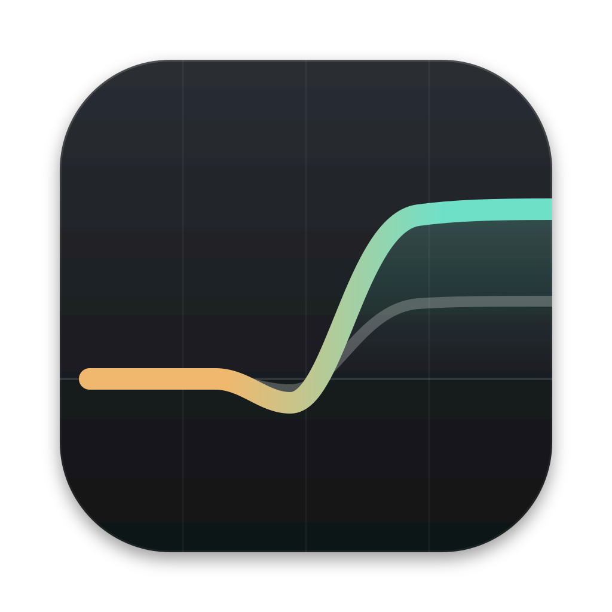
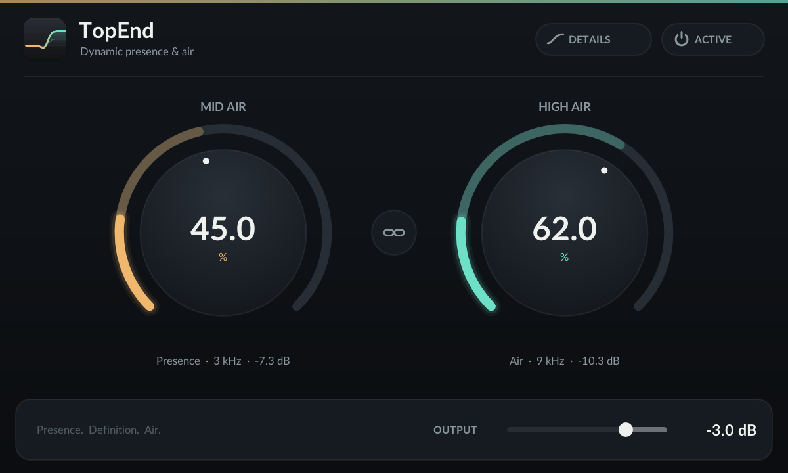
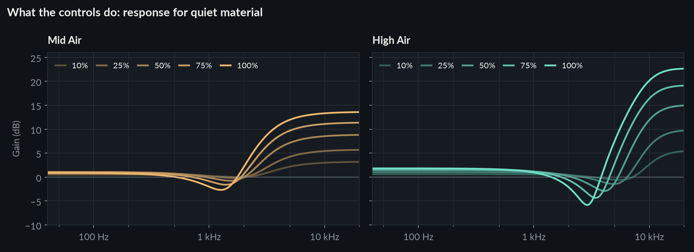
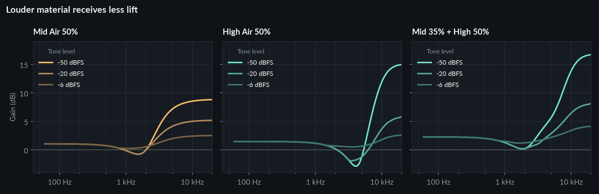
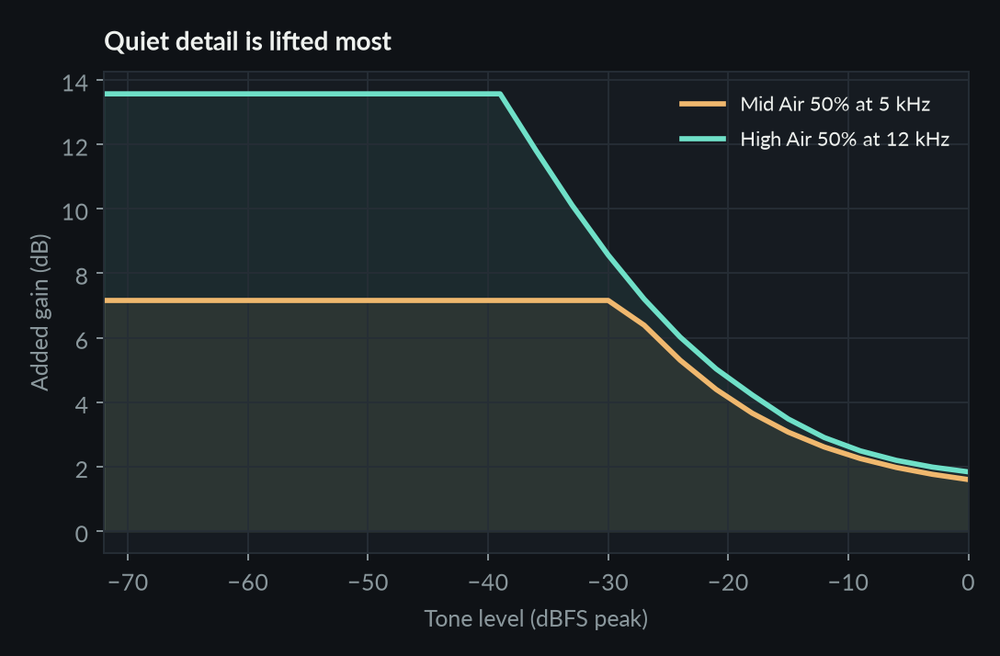
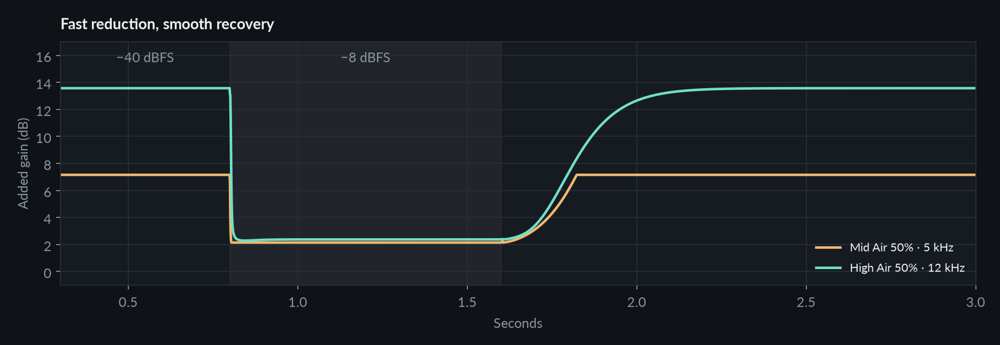
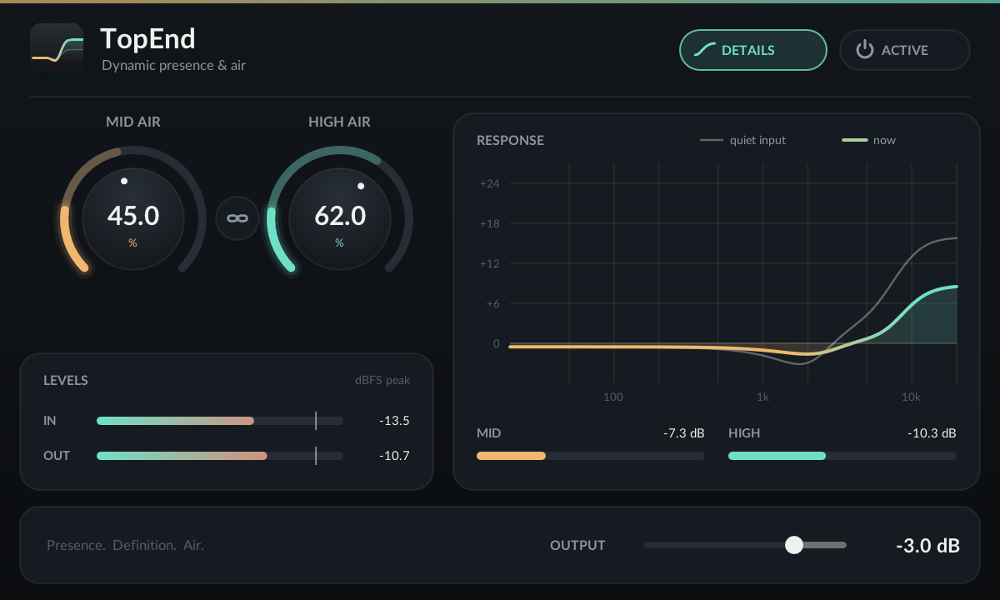

<p align="center">
  
</p>

<h1 align="center">TopEnd</h1>

<p align="center">
  <strong>Presence. Definition. Air.</strong><br>
  A dynamic enhancer that brings out upper-mid presence and high-frequency detail,<br>
  lifting quiet detail most and backing off when the top end gets loud.
</p>

<p align="center">
  <a href="https://github.com/BTFLV/TopEnd/releases/latest"></a>
  <a href="https://github.com/BTFLV/TopEnd/actions/workflows/ci.yml"></a>
  
  
  <a href="LICENSE"></a>
</p>

<p align="center">
  
</p>

## Highlights

- **Two enhancement bands.** Mid Air adds presence above about 3 kHz; High Air
  adds air and brilliance above about 9 kHz.
- **Dynamic, not static.** Each band runs through its own 4:1 dynamics, so quiet
  detail gets the most lift and loud, bright material is not pushed further.
- **Shows what it does.** The bright part of each ring is the enhancement acting
  right now. Details opens a live response curve, per-band reduction and levels.
- **Clean and light.** Zero latency, no oversampling or saturation, sample-exact
  bypass, about 0.23% of one Apple M4 core per stereo instance at 48 kHz.
- **No strings.** No account, activation, license server or background service.
  MIT licensed.

## Download

Get the latest disk image from
[**Releases**](https://github.com/BTFLV/TopEnd/releases/latest). It contains
AUv2, VST3 and CLAP plugins for Apple Silicon Macs running macOS 11 or newer.
Copy them into your plugin folders and rescan in your host:

| Plugin | Folder |
| --- | --- |
| `TopEnd.component` | `~/Library/Audio/Plug-Ins/Components` |
| `TopEnd.vst3` | `~/Library/Audio/Plug-Ins/VST3` |
| `TopEnd.clap` | `~/Library/Audio/Plug-Ins/CLAP` |

Release builds are signed with a Developer ID and notarized by Apple when the
release pipeline has signing credentials; each release states which applies.

## The sound

### What the controls do

For quiet material, each control raises its band smoothly, up to about +14 dB
for Mid Air and +23 dB for High Air at 100%. Just below each band the parallel
path adds to the dry signal slightly out of phase, which gives a shallow dip
before the lift. Raising a control also adds a little broadband level.



### Louder material receives less lift

The same settings measured with tones at three levels. Loud high-frequency
content is enhanced much less than quiet detail, so the top end gains detail
without simply getting louder.



<table>
  <tr>
    <td width="50%"></td>
    <td width="50%">
      <h3>Quiet detail is lifted most</h3>
      Below its threshold each band adds its full amount. Above it, the added
      gain falls with a 4:1 slope, so the enhancement fades out as material
      gets louder instead of stacking on top of it.
    </td>
  </tr>
</table>

### Fast reduction, smooth recovery

When a loud passage arrives, both bands pull back within a millisecond or two.
Afterwards Mid Air returns over a few hundred milliseconds and High Air along a
gentle S-curve, so sustained brightness does not pump on every transient.



All graphs are rendered from the plugin's DSP at 48 kHz with
`tools/product_graphs.py`. Start with modest settings, compensate with Output
and compare at matched loudness. TopEnd does not limit; peaks can exceed 0 dBFS.

## The editor

<table>
  <tr>
    <td width="50%"></td>
    <td width="50%"></td>
  </tr>
  <tr>
    <td>Compact: the dim arc is the setting, the bright arc the enhancement acting now.</td>
    <td>Details: response for quiet input versus the current signal, band reduction and levels.</td>
  </tr>
</table>

Both screenshots are real renders of the plugin at 2× scale while it processes
pink noise at about −26 dBFS RMS.

| Control | Behavior |
| --- | --- |
| Mid Air | 0–100%, dynamic presence above about 3 kHz |
| High Air | 0–100%, dynamic air above about 9 kHz |
| Link | Moves both controls by the same amount, keeping their offset |
| Output | −12–0 dB loudness compensation |
| Bypass | 21 ms crossfade to the input; host bypass uses the same crossfade |
| Details | Live response, band reduction and input/output levels |

Drag or scroll a knob, hold Shift or Command for fine control, and double-click
to type a value. The window is 600 × 360 points and resizes from 480 × 288 to
1200 × 720. Parameter changes glide over about 11 ms regardless of buffer size,
saved sessions start at their stored settings, and processing adds no latency.

## How it works

Each channel is the dry signal plus two parallel high-pass paths (3 kHz and
9 kHz, second order). Each path's level is reduced by stereo-linked 4:1
dynamics: a peak detector for Mid Air, and for High Air a power-averaging stage
followed by a peak stage that responds to the control amount. Gain smoothing
happens after the threshold in the decibel domain, which gives the immediate
attack and soft recovery shown above. Details are in
[docs/dsp-design.md](docs/dsp-design.md).

## Building from source

Requirements: an Apple Silicon Mac with the Command Line Tools, CMake 3.25+,
Ninja and Python 3. Full Xcode is not needed.

```sh
git clone --recurse-submodules https://github.com/BTFLV/TopEnd.git
cd TopEnd
python3 tools/bootstrap.py
cmake -S . -B build-release -G Ninja -DCMAKE_BUILD_TYPE=Release \
  -DTOPEND_BUILD_PLUGINS=ON -DCMAKE_OSX_DEPLOYMENT_TARGET=11.0 \
  -DCMAKE_OSX_ARCHITECTURES=arm64
cmake --build build-release
python3 tools/install.py --build build-release/out
```

The installer copies the three bundles into your user plugin folders, replaces
only existing TopEnd bundles and applies a local ad-hoc signature. The DSP core,
tests and an offline renderer also build without the plugin SDKs:

```sh
cmake -S . -B build -G Ninja -DCMAKE_BUILD_TYPE=Release
cmake --build build
ctest --test-dir build --output-on-failure
build/topend-render input.f32 output.f32 48000 2 512 35 50 -3
```

Python helpers render WAV files, analyze them and prepare blind A/B pairs
(`tools/render_audio.py`, `tools/analyze_audio.py`, `tools/listening_pairs.py`).
Install their pinned packages with
`python3 -m venv .venv && .venv/bin/pip install -r tools/requirements-lock.txt`.

## Quality checks

Every push builds the plugins and runs the DSP tests, `auval`, the official
VST3 validator, the CLAP validator and pluginval at strictness 5. Tests cover
sample rates from 8 to 384 kHz, any block size, mono and stereo, extreme and
subnormal input, ramps, state handling, zero allocations in the audio callback
and the editor's response curve against processed audio. Headless AU and CLAP
renders are sample-identical to the DSP core. See [docs/testing.md](docs/testing.md).

Not yet covered by automated checks: playback, bounces and recorded automation
inside DAWs, and blind listening on real recordings.

## Releases

Pushing a tag `vX.Y.Z` that matches the version in `CMakeLists.txt` builds,
tests and packages TopEnd and publishes a GitHub release with notes from
[CHANGELOG.md](CHANGELOG.md). When the repository secrets
`APPLE_CERTIFICATE`, `APPLE_CERTIFICATE_PASSWORD` and `APPLE_SIGNING_IDENTITY`
exist, the plugins are signed with a Developer ID; with `APPLE_API_KEY`,
`APPLE_API_ISSUER` and `APPLE_API_KEY_CONTENT` as well, the plugins and disk
image are notarized and stapled. Without them the release is published ad-hoc
signed. `tools/package_macos.sh` performs the same packaging locally.

## Documentation

- [DSP design](docs/dsp-design.md): signal model, dynamics and realtime contract
- [Editor design](docs/gui-design.md): views, interaction and implementation
- [Architecture](docs/architecture.md): framework, threading and adapter fixes
- [Testing](docs/testing.md): coverage, validators and results
- [Changelog](CHANGELOG.md)

## License

TopEnd is released under the [MIT License](LICENSE). It is built with
[iPlug2](https://github.com/iPlug2/iPlug2), the
[VST3 SDK](https://github.com/steinbergmedia/vst3sdk) and
[CLAP](https://github.com/free-audio/clap), and uses the Lato typeface; their
licenses are collected in [THIRD_PARTY_NOTICES.txt](assets/THIRD_PARTY_NOTICES.txt).
